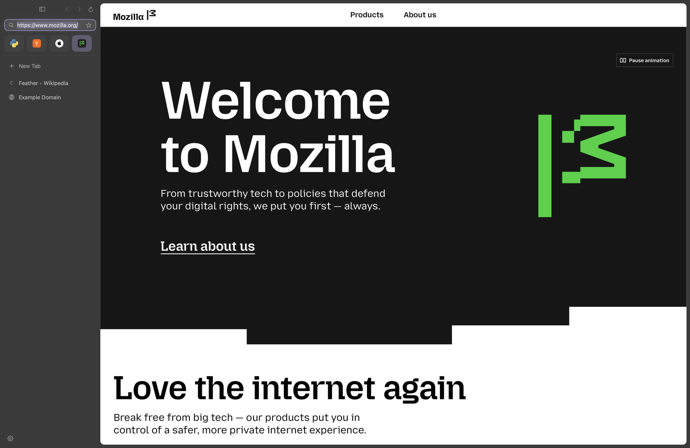
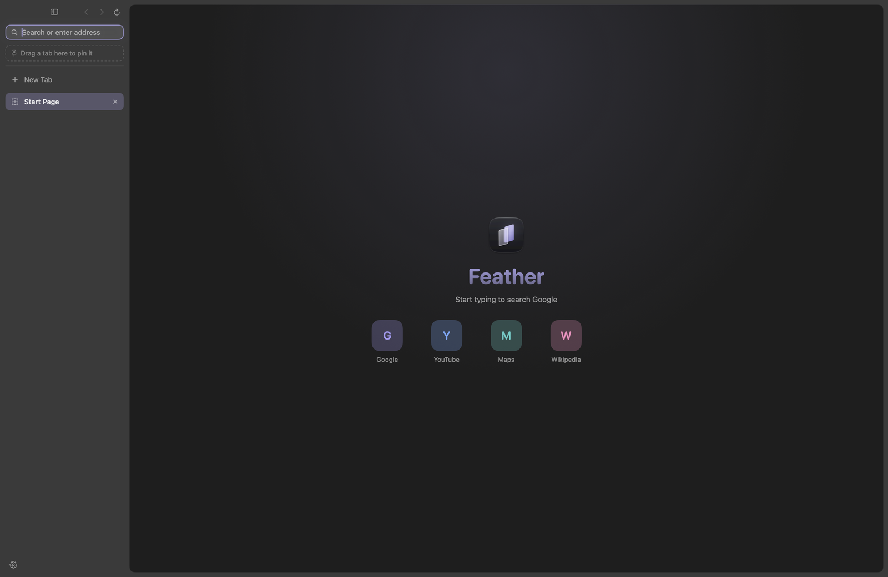

# Feather

A small, native macOS browser built on WebKit. Vertical sidebar tabs, a calm interface with considered motion, and a tab lifecycle that unloads pages you aren't using to keep memory in check. Swift, SwiftUI and `WKWebView`; no third-party dependencies, no accounts, no telemetry.

> **Status: early alpha.** One developer, one machine. It is usable for everyday browsing, but it is missing things you may rely on (see [What's not there yet](#whats-not-there-yet)) and the app is **not notarized**. Expect rough edges.



## Features

- **Sidebar tabs**, with **pinned tabs** as an icon grid at the top. Drag to reorder, drag onto the pin area to pin, drag back to unpin. Hide the sidebar with ⌘S for a compact top bar.
- **One address bar** for URLs and Google searches. It takes focus on every new tab.
- **Memory-conscious by design.** Blank and restored tabs have no web view at all; pages in tabs you haven't visited are unloaded according to a setting (Balanced / Memory Saver / Aggressive). A tab is never unloaded while it is loading, playing media, using the camera or microphone, on an excluded site, or has text typed into a form.
- **Crash-safe sessions.** Your tabs, pins, selection, and each tab's back/forward history and scroll position are saved within about a quarter of a second of any change and restored after a quit, crash or `kill -9`, with backups and safeguards against a damaged session file (see [Keeping your tabs safe](#keeping-your-tabs-safe)). Only the selected tab loads at launch. If WebKit's page process dies, the tab reloads itself.
- Bookmarks, local history, downloads, find in page, per-site zoom, printing, camera/microphone/location prompts, file upload, JavaScript dialogs, local HTML files.
- **Default-browser support**: opens links from other apps.
- A start page with your bookmarks and recent sites, a lavender brand palette, and animations that only run in response to what you do (all disabled by macOS *Reduce motion*).



## Keeping your tabs safe
Your open tabs, pins, selection, each tab's back/forward list and scroll position, and the recently-closed list are saved within about a quarter of a second of any change, and whenever you leave the app, sleep the Mac, or quit.

- **Writes are durable.** Each save goes to a temporary file, is forced to disk, read back and compared, and only then renamed into place. The previous save is kept as `session.prev.json`.
- **Nothing unreadable is ever overwritten.** If the session file is damaged, Feather restores the previous save, then the newest backup, and first copies every damaged file into `SessionQuarantine/`. One damaged tab entry costs only that tab.
- **Rolling backups** live in `SessionBackups/`: every 10 minutes while things change, at launch, at quit, and *before* a sudden drop in the number of tabs, so a mistaken mass-close can be undone. **History > Restore Previous Session** opens a backup's tabs alongside the ones you have (nothing is replaced).
- **You are told** when something went wrong (a restore from backup, a damaged file, a save that failed and is being retried) in a banner over the window.
- **One Feather per profile.** A second copy opening the same profile can't write to it.

**Limits:** changes in the last fraction of a second before a crash, text typed into web forms, and a page's JavaScript state are not saved. Tested by killing the app (`kill -9`), quitting, damaging the files in every way listed in [docs/DEVELOPMENT.md](docs/DEVELOPMENT.md), and loading a copy of a real session. **Not tested:** a power cut or Mac restart in the middle of a save, which needs a real restart.

## What's not there yet

No password manager or AutoFill, no extensions, no ad/tracker blocking, no private browsing, no download list (just a progress badge), no sync, one window only. Text typed into a web form and a page's JavaScript state are **not** restored after a crash. Sign-in flows for large sites (Google, Microsoft) inside `WKWebView` are not systematically tested.

## Memory: a goal, not a result

Feather is designed to be light, but **no measurements against Safari or any other browser have been recorded yet**, so it makes no claim to use less memory than they do. A benchmark harness is included ([BENCHMARKING.md](BENCHMARKING.md)); run it before trusting any comparison.

## Privacy

No analytics, accounts or telemetry. Tabs, history and bookmarks are stored locally in the app's sandbox container. Besides the pages you open, Feather makes one request of its own: it downloads the icon of sites you visit to show in the tab. Icons are saved locally (about 1-4 KB each, at most 400 files, refreshed weekly) so tabs show them straight after a relaunch; Clear History removes them except for sites you still have open or bookmarked. The default search engine is Google, so searches typed in the address bar go to Google. The app runs in the macOS App Sandbox.

## Build and run

Requires macOS 14 or later, Xcode, and [XcodeGen](https://github.com/yonaskolb/XcodeGen) (`brew install xcodegen`).

```sh
xcodegen generate
xcodebuild -project Feather.xcodeproj -scheme Feather -configuration Release -derivedDataPath build build
open build/Build/Products/Release/Feather.app
```

The app is signed ad hoc, not with a Developer ID, and is not notarized. If you copy it elsewhere and macOS refuses to open it, use *System Settings → Privacy & Security → Open Anyway*. To make it your default browser, use the button in Feather's Settings.

## Keyboard shortcuts

| | | | |
|---|---|---|---|
| New tab | ⌘T | Close tab | ⌘W |
| Reopen closed tab | ⇧⌘T | Open location | ⌘L |
| Back / Forward | ⌘[ / ⌘] | Reload | ⌘R |
| Next / previous tab | ⇧⌘] / ⇧⌘[ or ⌃⇥ / ⌃⇧⇥ | Go to tab 1–9 | ⌘1 … ⌘9 |
| Pin / unpin tab | ⇧⌘P | Hide / show sidebar | ⌘S |
| Bookmark page | ⌘D | Find in page | ⌘F, ⌘G, ⇧⌘G |
| Zoom in / out / reset | ⌘= (⌘+) / ⌘- / ⌘0 | Print | ⌘P |

## Development

See [docs/DEVELOPMENT.md](docs/DEVELOPMENT.md) for the architecture, launch arguments, and the automated tests (a lifecycle self-test, a kill-and-relaunch restore suite, a readiness suite, and a real-mouse drag-and-drop test).

## License

[MIT](LICENSE). Icon design: created for this project.
